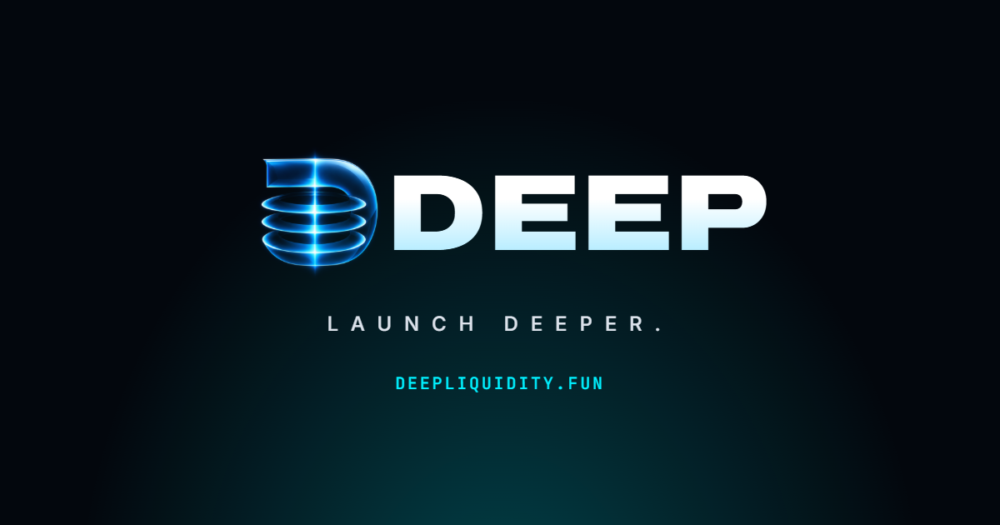

  

<h3 align="center">A Solana launchpad and DEX in one.</h3>

  Every token follows the same path: <b>launch → trade on the curve → fill → graduate → DeepSwap</b>.

  
  
  
  

---

### What DEEP is

| | |
| --- | --- |
| 🚀 **Deep Curve launchpad** | Fair launches on a bonding curve. Fixed supply, mint authority revoked at creation. Each buy moves the token deeper until the curve sells out. |
| 🌊 **Graduation** | When the curve fills, its SOL and the reserved tokens seed a **DeepSwap** pool in the same transaction, and the pool's LP tokens are burned. |
| 🔁 **DeepSwap DEX** | DEEP's own constant-product AMM (a fork of Raydium cp-swap, Apache-2.0). Anyone can create a pool for any two tokens, including Token-2022, and add or remove liquidity. |
| 💸 **Creators earn** | A share of every curve trade, plus a creator fee on swaps in their token's graduation pool, claimable from the app. |
| 📈 **Stock pairs** | Tokenized-stock pairs with issuer controls shown up front. Test stocks on devnet; mainnet only after legal review. |
| 🔍 **Open by design** | Fees, curve parameters and pool state are read from chain; config changes go through an on-chain timelock. |

### Build on DEEP

- **[deep-sdk](https://github.com/Deep-Liquidity/deep-sdk)**: TypeScript SDK with program IDLs, PDAs, instruction builders, account and event decoders, and the exact integer curve and fee maths.
- **Public API**: tokens, trades, candles, pools and pairs at `https://api.deepliquidity.fun/v1`.
- **Integration guide** for terminals and aggregators in the [docs](https://docs.deepliquidity.fun/docs#integrate).

### Status

DEEP is in **devnet beta**: test SOL only, devnet tokens have no value, and mainnet is not live. The programs have **not been audited** yet; an independent audit comes before any mainnet release.

### Links

[Website](https://deepliquidity.fun) · [App (devnet)](https://devnet.deepliquidity.fun) · [Docs](https://docs.deepliquidity.fun/docs) · [Blog](https://blog.deepliquidity.fun) · [Status](https://status.deepliquidity.fun) · [X](https://x.com/LaunchOnDL) · [Telegram](https://t.me/LaunchOnDL)

Nothing here is financial advice. Memecoins are highly speculative.
